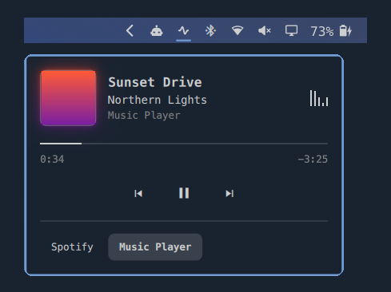
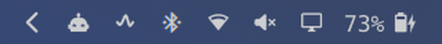

# Now Playing for Omarchy

<p align="center">
  
</p>

A minimal, music-only control for the Omarchy bar. A small sound wave moves while music plays and settles into a flat line when paused. The icon appears only while a music player has a track loaded.

Click it for artwork with a soft glow in the cover's own colours, track details, a progress bar, and previous, play and next controls. It uses your Omarchy theme and system font.

| Playing | Paused |
|---|---|
|  |  |

## Install

```bash
omarchy plugin add https://github.com/Profit94/omarchy-nowplaying.git --enable
omarchy bar move softwave.nowplaying --before omarchy.bluetooth
```

Plugins run unsandboxed inside the Omarchy shell, so review the code before installing it.

## Controls

| Input | Action |
|---|---|
| Left-click | Open the panel |
| Right-click | Play or pause |
| Middle-click | Next track |
| `←` / `→` in the panel | Previous or next track |
| `Space` or `Enter` in the panel | Play or pause |
| Drag the progress bar | Seek |
| Click a player in the panel's switcher | Show that player until the panel closes |

## What counts as music

Known music apps such as Spotify and Cider always count. Anything else, including browsers and video players, needs evidence: an audio file, a known music site, or an album and artist on the track. A regular YouTube video stays out.

Chromium-based browsers may not report the page address, so a music site that reports no album stays hidden. Apple Music has no native Linux app, so use Cider or the website.

## Settings

Set these with `omarchy bar set softwave.nowplaying <key> <value>`.

| Key | Default | Meaning |
|---|---|---|
| `showWhenPaused` | `true` | Keep the icon while music is paused (add `--json` when setting it) |
| `extraPlayers` | empty | Comma-separated player names to treat as music. This also lets that player's videos through |

## Privacy and performance

- It reads player information over MPRIS. While the panel is open, `curl` downloads the cover from the address the player supplies, which is usually the music service. Covers are kept temporarily in `$XDG_RUNTIME_DIR/omarchy-nowplaying`.
- The level bars read your audio output's level, only while the panel is open and music is playing. No audio is recorded or sent anywhere.
- The moving icon typically uses about 3–4% of one CPU core while playing, with occasional spikes up to about 15%. It stops when paused and when animations are off with `omarchy toggle animations`.

## Known issues

- The CPU spikes aren't fully explained. They appear across the shell's main, render and Wayland threads, and moving the pointer along the bar raises the shell's CPU use even with no music playing, so the shell's own activity is at least part of it.
- On one tested setup, Spotify's GPU helper crashed under XWayland. Adding `--ozone-platform=wayland` to `~/.config/spotify-flags.conf` stopped it there.

## Tests

```bash
node tests/model.test.js
```
